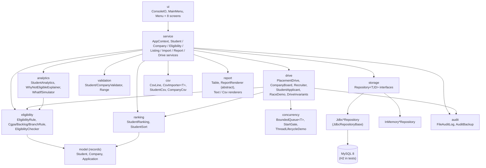
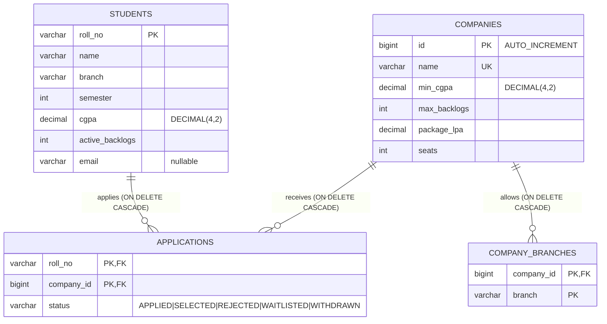

# PlaceWise - Architecture

## 1. Components

Dependencies point downwards: the menu knows the services, the services know the domain and the repositories, and
the domain knows nothing about the outside world (no I/O, no database, no threads).



`AppContext` is the composition root: with a `Database` it wires the JDBC repositories, without one the in-memory
repositories. Nothing above the repository interfaces can tell which one it got.

## 2. One application inside the placement drive

```mermaid
sequenceDiagram
    autonumber
    participant S as student-N thread
    participant G as StartGate
    participant Q as BoundedQueue
    participant R as recruiter-K thread
    participant E as EligibilityChecker
    participant B as CompanyBoard (its own lock)
    participant A as FileAuditLog

    S->>G: awaitOpen() - waits until main opens the gate
    S->>A: log(APPLICATION)
    S->>Q: put(application) - wait() while the queue is full
    R->>Q: take() - wait() while the queue is empty
    Q-->>R: application
    R->>E: check(student, company)
    R->>A: log(ELIGIBILITY_CHECK)
    alt not eligible
        R->>R: status = REJECTED
        R->>A: log(REJECTED, every failed reason)
    else eligible
        R->>B: admit(application)
        Note over B: synchronized(lock): take a free seat, or displace the<br/>worst selected student, or join the waitlist,<br/>or be rejected as a duplicate
        B-->>R: List of Decision (the lock is already released)
        R->>A: log(each Decision)
    end
    Note over S,R: later, when all students are done:<br/>main closes the queue, recruiters drain it and stop;<br/>withdrawal threads then call board.withdraw(), which promotes the waitlist
```

Phases of `PlacementDrive.run()`:

1. **Plan** (main thread, seeded `Random`): which companies each student applies to, plus deliberate duplicate applications.
2. **Phase 1**: recruiters and student threads start, `gate.open()`, `join` all students, `queue.close()`, `join` all recruiters.
3. **Phase 2**: a seeded fraction of the selected students withdraw, on several threads at once; the waitlist is promoted.
4. **Always** (`finally`): close the queue, stop the monitor, interrupt and join any thread still alive.

## 3. Eligibility and ranking rules

**Eligibility** (`EligibilityChecker` applies every `EligibilityRule` and keeps *every* failure reason):

| Rule | Passes when | Example failure text |
|---|---|---|
| `CgpaRule` | `student.cgpa.compareTo(company.minCgpa) >= 0` | `CGPA 6.80 is below required 7.50` |
| `BacklogRule` | `student.activeBacklogs <= company.maxBacklogs` | `3 active backlog(s) exceed the allowed maximum of 1` |
| `BranchRule` | company's branch set is empty **or** contains the student's branch | `Branch ECE is not allowed (allowed: CSE, IT)` |

CGPA is a `BigDecimal` with two decimals. Equality passes, one hundredth below fails, and comparisons use `compareTo`
(never `equals`, because `7.5` and `7.50` are different `BigDecimal`s but the same grade).
`EligibilityChecker.check` runs every rule in a plain loop and does not stop at the first failure, so every reason is kept.

**Ranking** (`StudentRanking.ORDER`), strict total order:

1. CGPA, **higher** first
2. **fewer** active backlogs
3. name, ignoring case
4. roll number (unique, so two different students can never tie)

`rank()` numbers 1..n; `top(n)` is `limit(n)`; `page(p, size)` is `skip((p-1)*size).limit(size)` and keeps the global rank
numbers on later pages.

**Explainer**: for every rejecting company it reports the exact gap: CGPA shortfall (`company.min - student.cgpa`),
backlog excess (`student.backlogs - company.max`), and a blocked branch, e.g. `Needs +0.70 CGPA and 1 fewer backlog`.
**What-if**: builds a *copy* of the student (`withCgpa`, `withActiveBacklogs`; CGPA capped at 10.00, backlogs floored at 0)
and asks the same checker about it; the stored student is never touched because `Student` is immutable.

## 4. Seat allocation and why it is correct

`CompanyBoard` holds, per company, two priority queues:

* `selected` - at most `seats` applications, **worst-ranked on top** (so the weakest incumbent is `peek()`);
* `waitlist` - every other eligible applicant, **best-ranked on top**.

`admit(a)`: duplicate student → REJECTED. Free seat → SELECTED. Otherwise compare `a` with the weakest selected `w`:
if `a` ranks better, `w` moves to the waitlist and `a` is SELECTED; if not, `a` joins the waitlist.
`withdraw(a)`: remove from `selected`, then promote `waitlist.poll()` in the same locked step.

*Invariant:* after any sequence of admits, `selected` holds the best `min(seats, n)` of the `n` distinct applicants seen
so far and every waitlisted applicant ranks below every selected one. *Proof sketch by induction:* a newcomer either
fills a free seat (then there were fewer than `seats` applicants, all selected), or is compared with the weakest selected
applicant, which is weaker than all other selected ones. If the newcomer is better, the swap keeps "best `seats`"; if not,
the newcomer is weaker than everyone selected, so waitlisting keeps the invariant. A withdrawal removes one selected
applicant and promotes the best waitlisted one, which again leaves the best `seats` of those remaining.

Consequence: **the final allocation depends only on the set of applications and withdrawals, not on thread timing.**
That is why the tests can compare every run with a naive "sort and take the top `seats`" reference (`DriveFixtures.expectedAllocation`).
`DriveInvariants` additionally checks: seats never exceeded; no seat free while someone waits; waitlist never outranks
selected; nobody selected twice for a company; no application left in `APPLIED`; only eligible students hold seats;
statuses and boards agree.

## 5. Locking strategy and why it is deadlock-free

| Lock | Guards | Held only inside | Calls out while held? |
|---|---|---|---|
| `CompanyBoard.lock` (one per company) | both priority queues, `seenStudents`, statuses of its applications | `admit`, `withdraw`, `snapshot`, `selectedCount` | never |
| `BoundedQueue` monitor | `items`, `closed` | `put`, `take`, `close`, `size`, `isClosed` (`wait()` releases it) | never |
| `StartGate` monitor | `open` | `open`, `awaitOpen` | never |
| `FileAuditLog` monitor | writer, `closed` | `log`, `close` | file I/O only |
| `ProgressCounter` monitor | two counters | tiny methods | never |
| `SafeSeatAllocator.locks[i]` | `remaining[i]` | `tryAllocate`, `seatsLeft` | only the demo's simulated slow work (`sleep`), no other lock |

**Rule:** no thread ever *requests* a lock while *holding* another one. A deadlock needs a cycle of threads each holding
a lock another one wants (hold-and-wait plus circular wait). Without hold-and-wait there can be no cycle, so deadlock is
impossible. How the code keeps to the rule:

* `CompanyBoard.admit/withdraw` do not log; they **return** `Decision`s, and the caller writes them to the audit log
  after the board lock is released (`Recruiter.process`, `WithdrawalWorker.run`).
* Each recruiter works on one application at a time and touches one board per application.
* A student thread calls `queue.put` holding nothing; the uncaught-exception handler records the failure
  (`synchronizedList`, released) before it calls `queue.close()`.
* `wait()` is the only place a thread blocks inside a `synchronized` block, and `wait()` *releases* that monitor.

Other safety measures: `Application.status` and `ProgressMonitor.running` are `volatile`; `Thread.start()` and `join()`
give happens-before edges (plans and boards are built before the threads start; results are read after `join`);
interrupts are never swallowed: `InterruptedException` propagates, workers restore the flag, and `PlacementDrive`
re-asserts it only *after* shutting its threads down.

## 6. Race-condition demo

`UnsafeSeatAllocator.tryAllocate` does `if (remaining > 0) { window.run(); remaining--; }` with no lock: between the check
and the update other threads pass the same check, so more seats are handed out than exist. `SafeSeatAllocator` performs
the identical steps inside `synchronized (locks[company])`. `RaceDemo` runs the *same* seeded workload against both and
counts how many seats each company really granted (each thread counts only into its own row, so the measurement itself
is race-free). The tests also force the bad interleaving deterministically with a two-thread rendezvous inside the window.

## 7. Persistence



Indexes: `students(branch, cgpa)` (a branch's students by CGPA) and `applications(company_id, status)` (seat counts per
company). `CHECK` constraints repeat the validation rules in the database as a second line of defence.

* `Repository<T, ID>` is generic. `JdbcRepositoryBase` is a small abstract parent with helpers (`connect`,
  `failure`, `rollback`, `isDuplicateKey`); each `Jdbc*Repository` writes its own SQL with plain JDBC code.
* **PreparedStatement only**, including the DDL in `SchemaInitializer`. User text is never part of the SQL string.
* Transactions are written out where they are used: `setAutoCommit(false)`, run, `commit()`; on failure `rollback()`
  (a failing rollback is attached as *suppressed*, not lost); auto-commit is switched back on in `finally`. The student
  batch import (`JdbcStudentRepository.saveAll`), company save/update and `replaceAll` of applications do this; a bad
  row rolls the whole batch back.
* Every operation opens its own connection in a try-with-resources block (no shared connection to corrupt or leak);
  the tests count opened vs closed connections and require zero left open.
* SQL errors become `PersistenceException`; a duplicate key (H2 `23505`, MySQL `23000`/1062) becomes
  `DuplicateRollNoException` or `InvalidCompanyException`.
